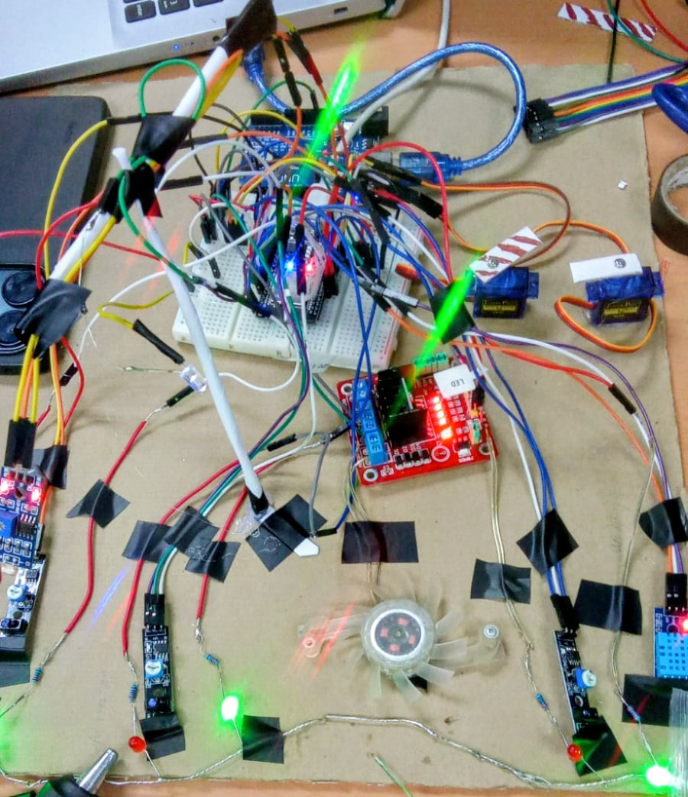
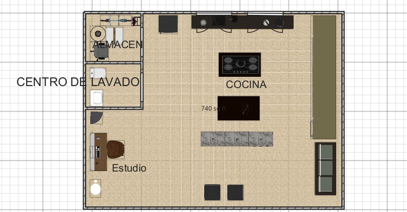
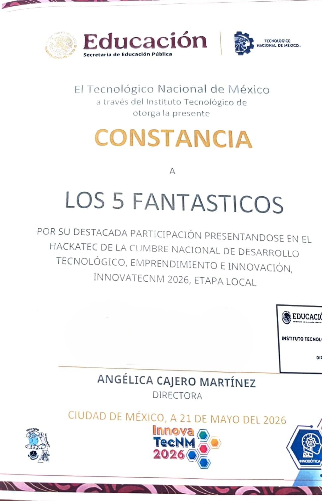

# ChefGuard IoT

Prototipo de cocina inteligente para supervisar las condiciones de un laboratorio de prácticas gastronómicas.

**Reconocimiento del equipo:** primer lugar en el HackaTec Local 2026 (InnovaTecNM) y clasificación a la etapa regional. **Equipo:** Los 5 Fantásticos, TecNM Campus Tláhuac.

## Problema y solución

En un laboratorio de cocina es difícil vigilar de forma continua la temperatura, la iluminación y la disponibilidad de las estaciones. El equipo desarrolló un prototipo que integra sensores, ventilación automatizada y una interfaz web de monitoreo.

## Funcionalidades

- Mide temperatura y humedad y detecta cambios en la iluminación.
- Detecta la disponibilidad de estaciones y comunica su estado mediante indicadores LED.
- Activa la ventilación según las lecturas de temperatura y muestra los datos en una interfaz web.

## Tecnologías

ESP32 y Arduino IDE para control y programación. DHT11, LDR y TCRT5000 para adquisición de datos. Servomotores, LED y L298N para actuación y señalización. Proteus para simulación electrónica y Sweet Home 3D para el plano del espacio.

## Mi contribución

Propuse y conceptualicé la idea, y maqueté y desarrollé la interfaz web. Colaboré en la lógica de control, la integración electrónica, la soldadura y el ensamblaje. También apoyé la coordinación del equipo y la presentación ante el jurado.

## Resultados

El equipo integró un prototipo físico funcional que combina sensores, actuadores y monitoreo web. En la etapa local, el equipo obtuvo el primer lugar por este proyecto.

## Evidencias del proyecto

### Prototipo y plano

 

Montaje electrónico del equipo y plano de la cocina, almacén, zona de lavado y área de monitoreo.

### Reconocimiento

Constancia de participación destacada del equipo en la etapa local.
